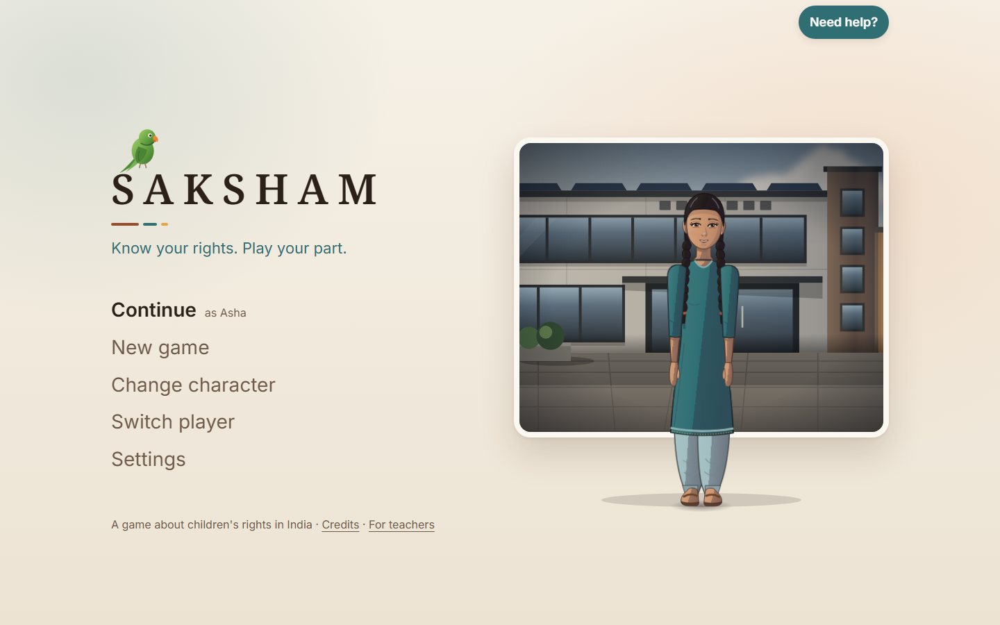
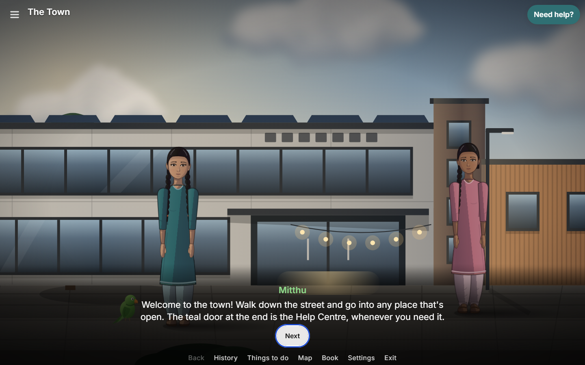
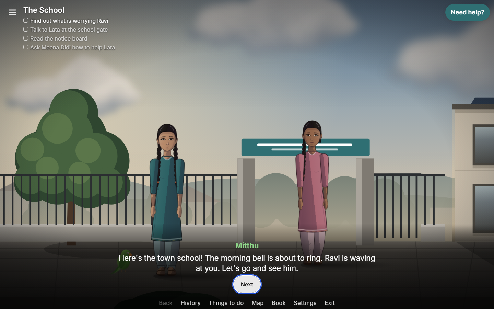
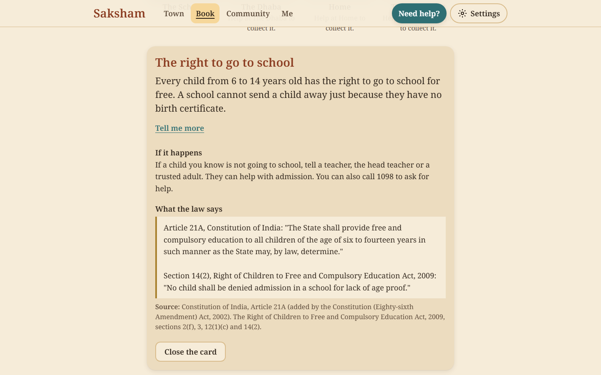
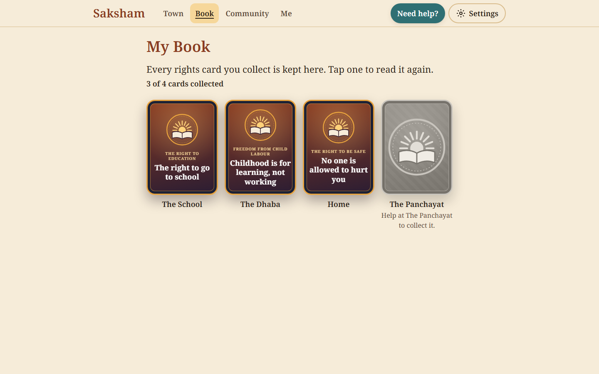
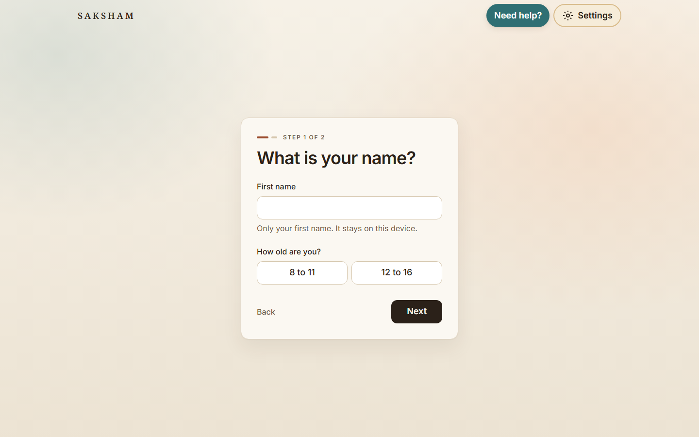
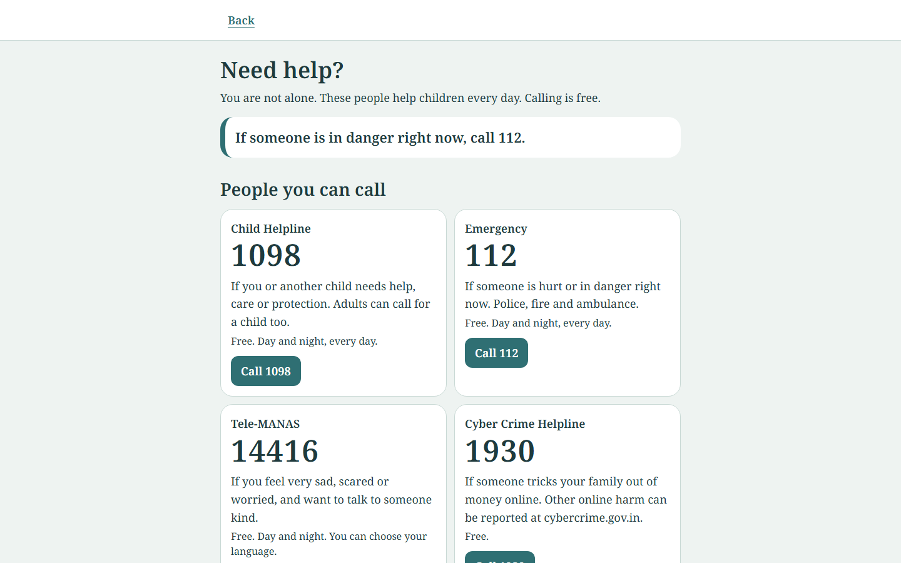
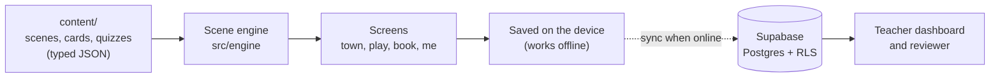

<div align="center">

# Saksham

**Know your rights. Play your part.**

A web game that teaches Indian children, aged 8 to 16, their legal rights.
They walk through a small town, talk to people, help solve a real problem, and earn a rights card that explains the law in words they understand.



</div>

---

## Why this exists

Most children in India have never been told that they have a right to go to school for free, that child labour is against the law, or that no one is allowed to hurt them. The laws exist, but they are written for lawyers, not for a ten-year-old.

Saksham turns those laws into stories. The child is never lectured. They see a problem in their own town, they help a friend, and the right is the answer they discover along the way.

The idea began as a Smart India Hackathon problem statement (SIH1281, Ministry of Law and Justice) and is being built as the UCS503 Software Engineering Lab project at Thapar Institute of Engineering and Technology, Patiala.

## How it plays

1. **Make your character.** Pick a first name, an age group, and a look.
2. **Walk the town.** Use the keyboard, a touch joystick, or tap to walk. Mitthu the parrot is your guide.
3. **Go into a building.** Each one has a problem: a friend who has stopped coming to school, a boy working at a roadside dhaba.
4. **Talk, notice, help.** Talk to people, read clues, and choose how to help. A weak choice shows a gentle result, and Mitthu lets you try again.
5. **Earn the rights card.** It explains the right in simple words, and shows the real law exactly as written.
6. **Play a quick game.** A short quiz, or a sort game, to check what you learned.
7. **Collect it.** The card goes into your Book, and the next building opens.

<table>
  <tr>
    <td width="50%"><br /><sub><b>The town.</b> A walkable street that grows as you finish buildings.</sub></td>
    <td width="50%"><br /><sub><b>The School.</b> Things to do, people to talk to, a problem to solve.</sub></td>
  </tr>
  <tr>
    <td width="50%"><br /><sub><b>A rights card.</b> Simple words first, then the real law and its source.</sub></td>
    <td width="50%"><br /><sub><b>The Book.</b> Every card you have earned, to read again any time.</sub></td>
  </tr>
  <tr>
    <td width="50%"><br /><sub><b>New game.</b> Only a first name, and it stays on the device.</sub></td>
    <td width="50%"><br /><sub><b>Help Centre.</b> Real helplines, one tap away from every screen.</sub></td>
  </tr>
</table>

## The buildings

| Building | The right it teaches | The law behind it |
| --- | --- | --- |
| **School** | The right to go to school | Article 21A, Right to Education Act 2009 |
| **Dhaba** | Childhood is for learning, not working | Article 24, Child and Adolescent Labour Act 1986 |
| **Home** | No one is allowed to hurt you (told in a gentle tone) | Article 39(f), Juvenile Justice Act 2015 |
| **Panchayat** | Grow up first, marry later | Prohibition of Child Marriage Act 2006 |

Playground and Cyber Adda are locked teasers for later chapters.

Younger players (8 to 11) and teens (12 to 16) see different card text, and teens get extra quiz questions.

The whole game can be played in **English or Hindi** (Settings). The law on each card is always quoted exactly as written.

## Built for classrooms

- **Teachers** make a class and share a six-letter join code. Children join with only their first name.
- **A live dashboard** shows the class's progress and which quiz questions the class finds hard.
- **The Class Mission** is a shared goal the whole class works towards together.
- **Reviewers** (a legal aid lawyer or faculty member) approve the legal text. Only approved content shows a "Reviewed" tick, and any change to the text sends it back for review.

## Safety comes first

These rules are built into the code and checked by automated tests.

- **"Need help?" is on every screen.** The Help Centre is calm on purpose: no animation, no sound, no points, never red.
- **The only personal data is a first name.** No child ever gets an email or a password.
- **Children never see each other's writing.** Pledges are chosen from a fixed list, and private questions stay on the device.
- **No leaderboards, no streaks, no comparing children.** Class goals are shared, not competitive.
- **The child is always the helper or a witness.** Harm to a child is never shown.
- **Legal text is shown exactly as written,** with its source. The code never rewords it.
- **No analytics, no tracking.** The only server the app talks to is its own database.
- **Works offline.** Everything is saved on the device first. The backend only syncs, and the game works fully without it.
- **Calm motion mode** turns off ambient animation for children who need it, and follows the device's reduced-motion setting.

## How it is built

| Part | Choice |
| --- | --- |
| App | React 19, TypeScript (strict), Vite |
| Styling and motion | Tailwind CSS v4, Motion |
| Saved progress | Zustand, saved on the device |
| Backend | Supabase: Postgres, anonymous sign-in for children, Row Level Security |
| Testing | Vitest (unit), Playwright (end to end and accessibility) |
| Quality checks | ESLint, TypeScript, a content validator, GitHub Actions CI |



**Scenes are data, not code.** Every building is a JSON file: its people, its dialogue, its choices and its rights card. The engine reads the file and plays it, and never refers to a building by name. Adding a new building means writing a new story, not new engine code.

**The database protects itself.** Row Level Security means a teacher can only read their own classes and a child can only read their own rows. Every rule has a test that signs in as two teachers and two children and checks that nobody sees what they should not.

## Run it locally

You need Node.js 24 or newer.

```bash
npm ci
npm run dev
```

Then open the address Vite prints. No account or `.env` file is needed: without Supabase settings the game runs fully offline.

Tip: type `demo` anywhere in the game (or press and hold the logo) to open every building at once.

## Check it

```bash
npm run lint
npm run typecheck
npm run test
npm run validate
npm run build
```

End-to-end tests (install the browser once with `npx playwright install chromium`):

```bash
npm run e2e
```

CI runs all of these on every pull request, including a build with no backend at all, to prove the game works offline.

## Project status

The project is built in eight phases. Each one ends in a reviewed pull request.

| Phase | What it covers | Status |
| --- | --- | --- |
| P0 Foundation | Project setup, tooling, CI | Done |
| P1 Core | Game rules, saved progress, the translation layer | Done |
| P2 Character and scene engine | The customisable character, walkable scenes | Done |
| P3 School end to end | The first complete building | Done |
| P4 Town and all buildings | The town, Dhaba, Home, Panchayat, the sort game, Community | Done |
| P5 Backend | Teacher classes, sync, the live dashboard, content review | Done |
| P6 Experience and Hindi | Storybook opening, sound, a livelier world, short natural dialogue, Hindi | Done (Hindi awaiting a fluent speaker's check) |
| P7 Hardening and documentation | Every screen size, accessibility, performance, final docs | Planned |

The legal text on each card is waiting for a final expert fact-check before children use the app.

## Documentation

- [Build plan](docs/BUILD_PLAN.md): every phase, task and approval gate
- [Decisions](docs/DECISIONS.md): 49 recorded design decisions, each with its reason and the alternatives
- [Architecture](docs/ARCHITECTURE.md): how the code fits together
- [Test report](docs/TEST_REPORT.md) and [sprint log](docs/SPRINT_LOG.md)
- [Setup](docs/SETUP.md) and [asset licences](docs/ASSET_LICENSES.md)

## Author

Built by **Bhavyam Misra** at Thapar Institute of Engineering and Technology, Patiala.
