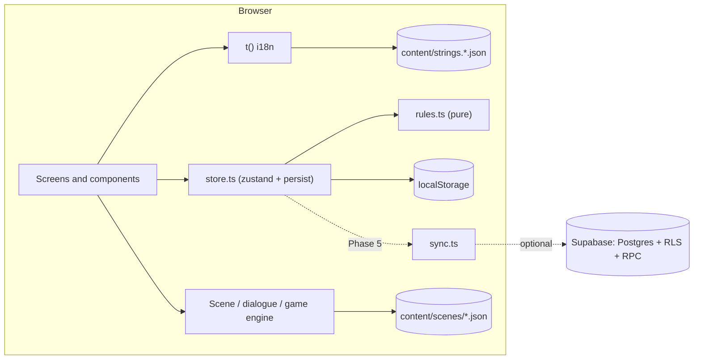

# Architecture

Saksham is a static single-page web app. Everything a child does runs in the browser and is saved on the device. A thin Supabase backend (Phase 5) only adds teacher features and sync. The app never depends on it.

## Principles

- **Local-first.** Every child feature works with no network and no Supabase env vars.
- **Data-driven.** Scenes, dialogue, cards and quizzes are typed JSON in `content/`. The engine plays any scene from its JSON alone and never refers to a building by id.
- **Pure rules.** Stars, unlocks, band filtering and merging are pure functions in `src/lib/rules.ts`, unit-tested.
- **One string table.** Every UI string comes from `content/strings.<lang>.json` through `t()`.

## Folder map

| Folder | Holds | Status |
| --- | --- | --- |
| `content/` | Typed JSON: UI strings, scenes, help copy; `types.ts` | `strings.en.json` (P0) |
| `src/lib/` | Plain TypeScript modules: `i18n.ts`, `calm.ts`, later `rules.ts`, `store.ts`, `sound.ts`, `sync.ts`, `supabase.ts` | `i18n`, `calm` (P0) |
| `src/engine/` | Scene, dialogue and game engines | P2 |
| `src/character/` | Paper-doll character rig and portraits | P2 |
| `src/screens/` | One component per route | P1 |
| `src/components/` | Shared UI pieces (buttons, top bar, Help button) | P1 |
| `supabase/` | Migrations, RLS tests, seed | P5 |
| `tests/e2e/` | Playwright end-to-end and safety-invariant tests | P0 |
| `docs/` | Plan, decisions, setup, licences, test report | P0 |

Path aliases: `@/…` → `src/…`, `@content/…` → `content/…`.

## Components (current and planned)

The Phase 5 sync sequence and join-class sequence will be added here as Mermaid sequence diagrams.

## Build and run

- `index.html` → `src/main.tsx`. That file sets calm mode, wraps the app in `HashRouter`, and renders `App`.
- `vite build` writes a static `dist/` with relative paths (`base: './'`), so it runs from any static host or sub-folder.
- CI (`.github/workflows/ci.yml`) runs lint, unit, build and e2e on every push and PR, then deploys `dist/` on `main` (see DECISIONS D-009).
