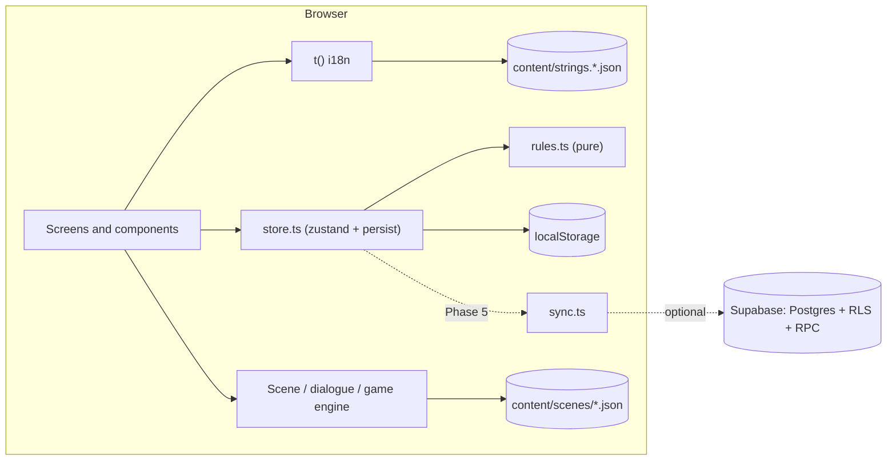
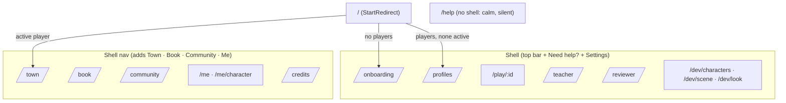
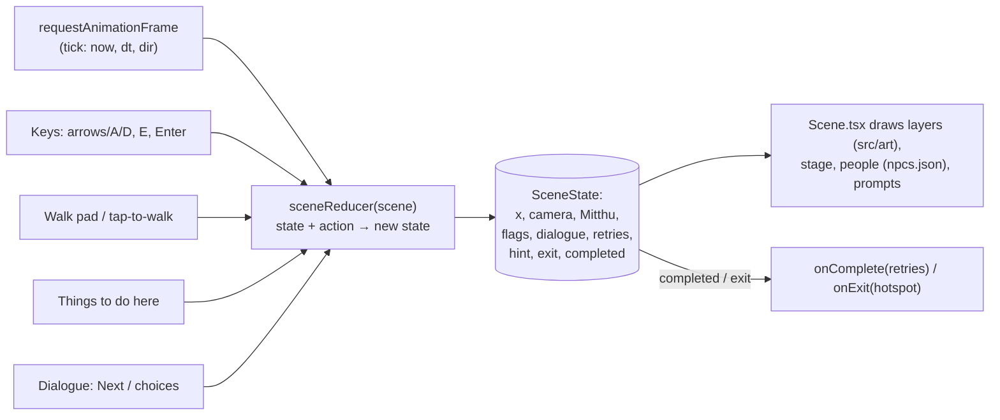

# Architecture

Saksham is a static single-page web app. Everything a child does runs in the browser and is saved on the device. A thin Supabase backend (Phase 5) only adds teacher features and sync. The app never depends on it.

## Principles

- **Local-first.** Every child feature works with no network and no Supabase env vars.
- **Data-driven.** Scenes, dialogue, cards and quizzes are typed JSON in `content/`. The engine plays any scene from its JSON alone and never refers to a building by id.
- **Pure rules.** Stars, unlocks, band filtering and merging are pure functions in `src/lib/rules.ts`, unit-tested.
- **One string table.** Every UI string comes from `content/strings.<lang>.json` through `t()`.

## Folder map

| Folder | Holds | Status |
| --- | --- | --- |
| `content/` | Typed JSON: UI strings, scenes, help copy, people; `types.ts` | `types.ts`, `strings.en.json`, `help.json`, `buildings.json` (P1); `npcs.json`, `scenes/sandbox.json` (P2) |
| `src/lib/` | Plain TypeScript modules: `i18n.ts`, `calm.ts`, `rules.ts`, `store.ts`, `sound.ts`, `scenes.ts` (content registry: building id → scene), later `sync.ts`, `supabase.ts` | P1, P3 |
| `src/engine/` | Pure scene logic (`movement.ts`, `story.ts`, `sceneState.ts`) and the scene player (`Scene.tsx`, `Dialogue.tsx`, `WalkPad.tsx`, `hooks.ts`, `people.ts`, `speech.ts`) | P2 |
| `src/character/` | SVG character rig (`Character.tsx`, `spec.ts`, `character.css`), game-style `CharacterBuilder`, `Portrait`, `Mitthu` | P2 (redesigned, D-024/D-025) |
| `src/play/` | The end of a building: `CardReveal`, `Quiz` (with the hint round), `Results` | P3 |
| `src/art/` | Scene art registry by key (`index.ts`), `sandbox.tsx`, `school.tsx` (School layers and props), `cover.tsx` (cover backdrop) | P2, P3 |
| `src/screens/` | One component per route: Onboarding, Profiles, Town (temporary hub), Play, HelpCentre, Me (+ character), guards, Placeholder; dev pages DevCharacters, DevScene, DevLook | P1 to P3 |
| `src/components/` | Shell (top bar + nav), HelpButton, SettingsDialog, Button, Page, SoundRouteSync | P1 |
| `supabase/` | Migrations, RLS tests, seed | P5 |
| `tests/e2e/` | Playwright end-to-end and safety-invariant tests | P0, safety in P1 |
| `scripts/` | `validate-content.ts` (content and strings checks, run in CI) | P1 |
| `docs/` | Plan, decisions, setup, licences, test report | P0 |

Path aliases: `@/…` → `src/…`, `@content/…` → `content/…`.

## Components (current and planned)

The Phase 5 sync sequence and join-class sequence will be added here as Mermaid sequence diagrams.

## Routes

`RequireProfile` guards `/town`, `/play/:id`, `/book`, `/community` and `/me`. Without an active player they go back to `/`.

## Scene engine (P2)

A scene is played by one pure reducer. React only sends actions and draws the state.

- Layers with `speed < 1` (or `front` not set) are drawn behind the stage, and layers with `speed > 1` or `front: true` in front. Speed 0 is fixed to the screen (the light layer). Film grain sits over every scene.
- The scene is 1000 design units tall, with the ground at `GROUND_Y` = 900. A child is 330 units tall and an adult 395.
- Calm mode turns off parallax, camera smoothing, the typewriter and all ambient motion. `gentle` scenes play sound at half volume and never nudge the screen.
- The engine never names a building. It reads only the SceneDef, the art registry by key, and `npcs.json`.

## Build and run

- `index.html` → `src/main.tsx`. That file sets calm mode, wraps the app in `HashRouter`, and renders `App`.
- `vite build` writes a static `dist/` with relative paths (`base: './'`), so it runs from any static host or sub-folder.
- CI (`.github/workflows/ci.yml`) runs lint, unit, build and e2e on every push and PR, then deploys `dist/` on `main` (see DECISIONS D-009).
