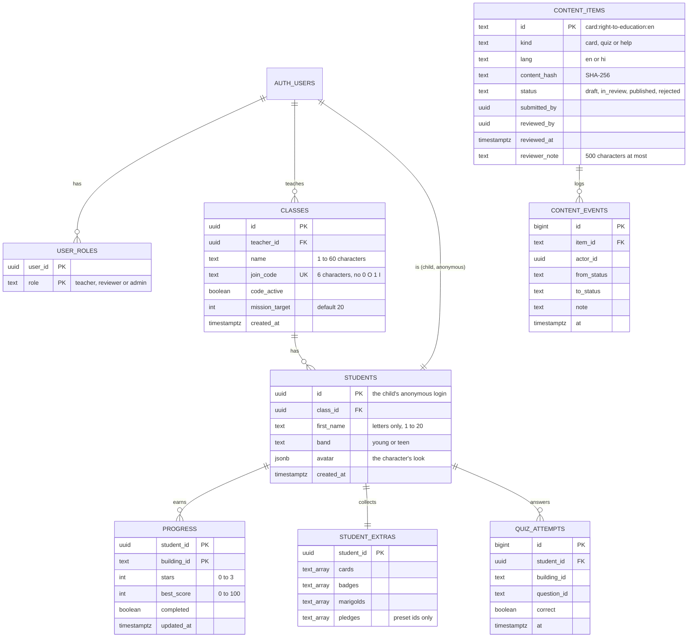

# Data model

The class server is one Postgres database on Supabase (D-043). The schema is in `supabase/migrations/`, and every rule below is tested by `supabase/tests/rls.test.sql` (45 checks, signed in as two teachers and two children).

The game itself keeps everything on the device first (`src/lib/store.ts`, local storage). The server only receives a copy when a child is in a class, so the game works fully without it (NFR-03, D-048).

## What is stored, and what never is

- **About a child:** a first name (1 to 20 letters), an age band and their character's look. Also their stars, collected cards, badges, preset pledge ids, and right or wrong for each quiz and sort answer.
- **Never stored:** a child's email, password, free text of any kind (Ask an Expert questions stay on the device), or anything about where they are (NFR-01).
- **About content:** only a SHA-256 hash and a review status. The words themselves live in the app's content files (D-049).

## Tables

**Merge rules** (triggers, so two devices can never lose each other's work, BUILD_PLAN §7):

- `progress` only goes up: stars and best score keep the higher value, and `completed` stays true once set.
- `student_extras` only grows: each list becomes the union of what was saved and what was sent.
- A new email account becomes a teacher automatically. An anonymous account (a child) gets no role.

**Views** for the teacher dashboard. Each uses the caller's own rights (`security_invoker`), so a teacher only ever sees their own classes:

- `class_progress_summary`: average stars and number finished, per class and building.
- `class_question_stats`: how many got each question wrong on their first try (first tries only, as in the game's scoring).
- `class_mission`: one star total for the whole class, never per child.

## Who can see and change what (row level security)

Every table has row level security turned on, and nothing can be reached without signing in (NFR-02). Children reach a class only through `join_class()` (see `API.md`).

| Table | A child (anonymous) | A teacher | A reviewer |
| --- | --- | --- | --- |
| `user_roles` | Read own (none) | Read own | Read own |
| `classes` | Read the one they joined | Create; read and update their own (name, code on or off, mission target) | No |
| `students` | Read own row; created only by `join_class`, removed by `leave_class` | Read and remove students in their own classes | No |
| `progress` | Read, add and update own | Read their students' | No |
| `student_extras` | Read, add and update own | Read their students' | No |
| `quiz_attempts` | Read and add own | Read their students' | No |
| `content_items` | Read status | Read status | Read status; change only through the review functions |
| `content_events` | No | No | Read the whole log (append-only, written by the functions) |

Deleting a class removes its students and all their class data (`on delete cascade`). A child leaving deletes their class data, while the game on their device keeps everything.
